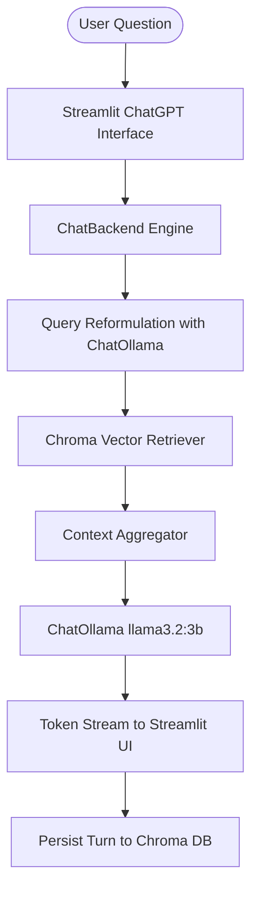

# Advance RAG Chatbot App

A modern, high-performance ChatGPT-style local RAG (Retrieval-Augmented Generation) application built with **Streamlit**, **LangChain**, **Chroma Vector DB**, and **Ollama (Llama 3.2)**.

---

## Features

- 💬 **ChatGPT-Inspired UI**: Clean, responsive layout with message bubbles, sidebar navigation, and session management.
- 🌓 **Dark & Light Mode**: Seamless one-click theme switcher with dynamic styling and high-contrast typography.
- 🔄 **Real-Time Token Streaming**: Real-time token streaming powered by `st.write_stream`.
- 🧠 **Context-Aware Query Reformulation**: Intelligently rephrases follow-up questions into standalone search queries using past chat history.
- 🗂️ **Chroma Vector Memory**: Stores and retrieves conversation context with session-level isolation (`{"session_id": session_id}`).
- 🔍 **Retrieval Transparency**: Expandable drawer under every assistant response showing the standalone search query and retrieved vector context chunks.
- ⚡ **Resource Caching**: Instant reruns using `@st.cache_resource` for embeddings and vector stores.

---

## Architecture Overview



---

## Project Structure

```
├── app.py                 # Streamlit frontend with Dark/Light mode and ChatGPT UI
├── backend.py             # RAG engine and Chroma DB session manager
├── retrieval_pipeline.py  # Standalone terminal CLI pipeline (original backend)
├── requirements.txt       # Python dependencies
├── run.bat                # One-click Windows launch script
└── database/
    ├── chroma_db/         # Chroma vector database storage
    └── sessions_meta.json # Session registry and titles
```

---

## Quickstart

### 1. Clone the Repository
```bash
git clone https://github.com/sounakthakur9045-creator/advance_RAG--chatbot-app.git
cd advance_RAG--chatbot-app
```

### 2. Set Up Virtual Environment & Dependencies
```bash
python -m venv .venv
# On Windows:
.venv\Scripts\activate
# On macOS/Linux:
source .venv/bin/activate

pip install -r requirements.txt
```

### 3. Ensure Ollama is Running
Make sure Ollama is installed and the `llama3.2:3b` model is downloaded:
```bash
ollama pull llama3.2:3b
```

### 4. Run the Application
```bash
streamlit run app.py
```
*(Or double-click `run.bat` on Windows)*

Open your browser at `http://localhost:8501`.
